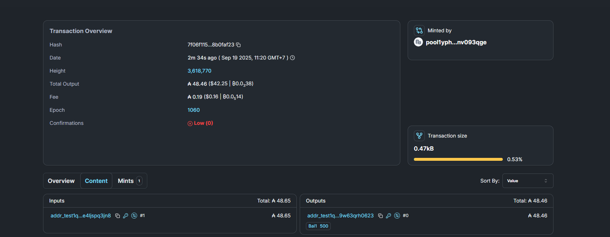
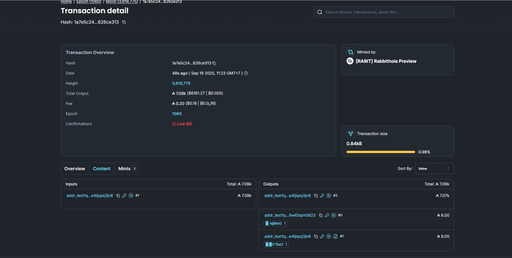

<div align="center">

# ⛓️ LS3 — Blockchain Academic Assignment

### *Bài tập lớn / Lab Thực hành Công nghệ Blockchain & Hợp đồng thông minh*

[](https://cardano.org/)
[]()
[]()
[](LICENSE)

---

<p align="center">
  <b>Dự án thực nghiệm nghiên cứu cơ chế sổ cái phân tán, mô hình eUTXO và logic Smart Contract On-chain / Off-chain.</b>
</p>

</div>

---

## 📌 Giới Thiệu Bài Tập

**LS3** (Lab / Study Assignment 3) là dự án bài tập lớn nằm trong chương trình nghiên cứu công nghệ Blockchain và Hệ thống phân tán. Mục tiêu của bài tập là tìm hiểu sâu về nguyên lý hoạt động của chuỗi khối, cơ chế quản lý trạng thái giao dịch và thiết lập logic hợp đồng thông minh (Smart Contract).

### 🎯 Các mục tiêu nghiên cứu & thực hành:
- ⛓️ **Cấu trúc Khối & Sổ cái**: Mô phỏng/xác thực chuỗi khối, tính toán mã hash và bảo mật giao dịch.
- 🔄 **Mô hình eUTXO (Extended UTXO)**: Xử lý trạng thái tài sản, các điều kiện đầu vào (Inputs), đầu ra (Outputs) và Redreamer/Datum.
- 📜 **Smart Contract Logic**: Viết và kiểm thử các hợp đồng thông minh on-chain, tối ưu hóa kích thước giao dịch và phí execution (Execution Units).
- 🧪 **Môi trường Testnet / Local Devnet**: Triển khai và test các luồng giao dịch trên mạng thử nghiệm.

---

## 🛠️ Công Nghệ & Công Cụ Sử Dụng

- **Mạng thử nghiệm**: Cardano Local Devnet / Preprod Testnet / Yaci DevKit.
- **Ngôn ngữ / Framework**: Aiken / Plutus / Typescript (MeshJS, Lucid) / Python / Rust.
- **Môi trường vận hành**: Docker CLI, VS Code, Git.

---

## 🏗️ Cấu Trúc Dự Án

```text
LS3/
├── contracts/          # Mã nguồn Hợp đồng thông minh (On-chain logic)
├── scripts/            # Kịch bản tương tác & gửi giao dịch (Off-chain code)
├── tests/              # Đơn vị kiểm thử (Unit tests & E2E integration tests)
├── docs/               # Báo cáo đồ án / Sơ đồ kiến trúc bài tập
├── docker-compose.yml  # Cấu hình môi trường Cardano Local Node / Devnet
└── README.md           # Tài liệu hướng dẫn sử dụng
     7f06f1155158ba310badd46cecbde066da1c63b2751ef4449829bed18b0faf23
 
   1a7e5c24f3d48d4afd640d480d7a0a429703326ad3d4078a947b3380626ce313   6c7df8253bd48360d55e6ffa3bd7792f1cd6fbf030f46d8a99f93e45ae178062
Cexplore tự dưng nay nó k xem được ấy ạ nên e để tx hash ở sau nhé !
